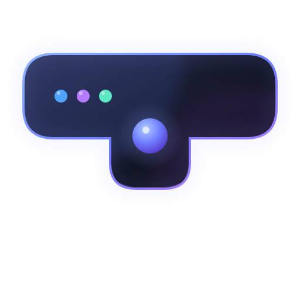
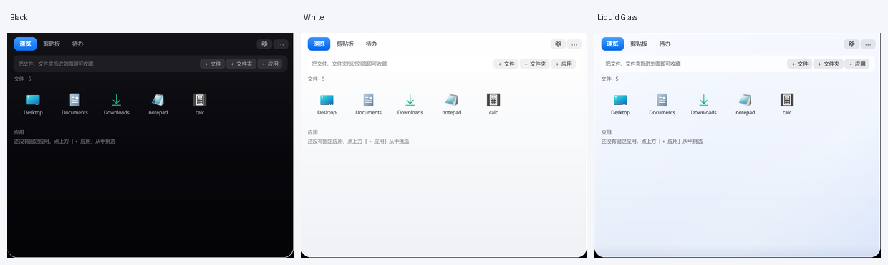
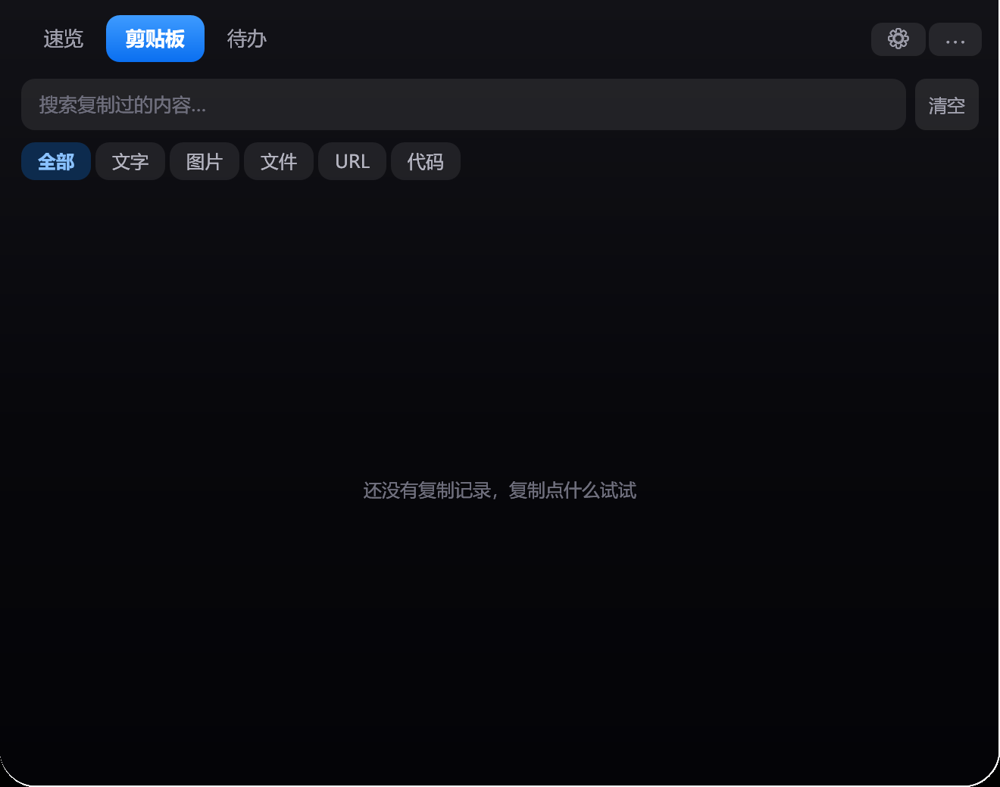
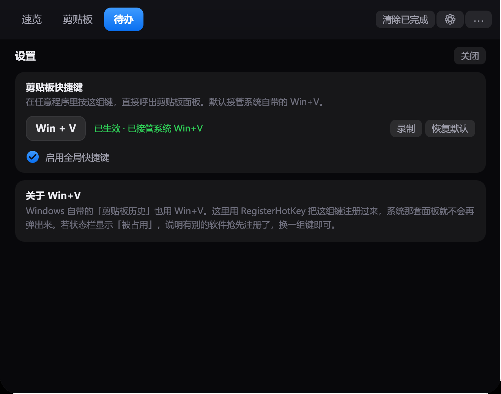

<p align="center">
  <picture>
    <source media="(prefers-color-scheme: dark)" srcset="assets/logo-mono.svg">
    
  </picture>
</p>

<h1 align="center">NotchDock</h1>

<p align="center"><b>常驻 Windows 屏幕顶部的「刘海」面板</b><br/>悬停毫秒级展开 · 离开立即收起</p>



三个功能：**收藏**（文件/文件夹与应用分栏）、**剪贴板历史**（最多 500 条，点一下直接粘贴回原光标位置）、**待办提醒**（自定义提前量）。默认接管 `Win+V` 呼出剪贴板页，可在设置里改键。

## 为什么不用 Electron / Tauri

需求核心是「鼠标碰到就展开」的响应速度。Web 容器（Electron/Tauri/WinUI+WebView）从鼠标消息到窗口尺寸提交至少要过一轮 IPC + 合成，实测普遍在 80–200ms，做不出「毫秒级」。这个项目用 **WPF + 原生 Win32 窗口**：鼠标消息直接进 UI 线程，改 `Width/Height` 当场生效，实测 11–19ms。

## 技术栈

| 层 | 选型 |
| --- | --- |
| UI | WPF（.NET 9），分层透明窗（`AllowsTransparency`）+ 自绘渐变/圆角，无边框无阴影 |
| 窗口 | `SetWindowPos` 置顶 + `WS_EX_TOOLWINDOW`（不进 Alt+Tab）+ `DwmSetWindowAttribute` 暗色 |
| 剪贴板 | `AddClipboardFormatListener` + `WM_CLIPBOARDUPDATE`（不轮询）；粘贴用 `SendInput` |
| 图标 | `SHGetFileInfo` 取系统图标（32px），带缓存 |
| 托盘 | WinForms `NotifyIcon`，图标取 exe 内嵌的 `Assets/NotchDock.ico`，与任务栏 / Alt+Tab 同一份 |
| Logo | `assets/logo.svg` 矢量源，`tools/make_logo.py` 可复现生成 SVG / PNG / ICO |
| 存储 | `%APPDATA%\NotchDock\config.json`，System.Text.Json |

## 目录

```
NotchDock/
├─ NotchDock.csproj        目标框架 net9.0-windows，UseWPF + UseWindowsForms
├─ Assets/NotchDock.ico    应用图标（exe / 托盘 / 窗口共用）
├─ app.manifest            PerMonitorV2 DPI
├─ GlobalUsings.cs         刻意不引入 System.Windows.Forms / System.Drawing（避免与 WPF 类型冲突）
├─ App.xaml(.cs)           调色板 + 控件样式（含二级菜单模板）、单实例、托盘、退出
├─ NotchWindow.xaml(.cs)   刘海窗：悬停/收起状态机、三个页签、拖放、页签切换
├─ DebugRender.cs          开发期预览：把窗口内容渲染成 PNG（--render <目录>）
├─ Models.cs               FavoriteItem / TodoItem / AppConfig
├─ Store.cs                JSON 读写（原子写 + 损坏文件备份）、日志
├─ Theme.cs                三套外观的调色板（macOS 系统色），运行时整体替换 Brush
├─ AppMenu.cs              菜单的声明式模型 + 两个渲染器（WPF / WinForms）
├─ AppIndexer.cs           开始菜单扫描（逐目录容错）+ Launcher
├─ ClipboardStore.cs       剪贴板历史：500 条上限、固定项、图片落盘
├─ ClipboardWatcher.cs     AddClipboardFormatListener + WM_CLIPBOARDUPDATE
├─ FocusKeeper.cs          「点一下就粘贴」：记录最近外部窗口 + SendInput Ctrl+V
├─ HotKey.cs               组合键模型：解析 "Win+V"、VK ↔ 名字
├─ HotKeyManager.cs        RegisterHotKey 注册全局热键 + 临时键盘钩子录制新键
├─ TodoScheduler.cs        10 秒扫描「截止 − 提前量」
├─ IconService.cs          SHGetFileInfo → ImageSource
├─ Native.cs               P/Invoke 集合
└─ Startup.cs / AutoStart  开机自启（HKCU Run）
```

仓库顶层还有：`assets/`（Logo 与界面预览）、`dist/NotchDock/`（编译好的免安装便携版）、`tools/`（开发期验证工具 + Logo 生成脚本）。

## 构建

需要 .NET 9 SDK。

```bash
dotnet build -c Release
dotnet publish -c Release -o ../dist/NotchDock      # 免安装目录，约 0.5 MB（框架依赖）
```

运行时依赖 **.NET 9 Desktop Runtime**（含 WPF/WinForms）。要在没有运行时的机器上跑，加 `--self-contained true`，体积约 70MB。

> 目标框架从 `net9.0-windows10.0.19041.0` 降到了 `net9.0-windows`：早期版本接过系统通知（WinRT），后来通知模块整体移除、换成剪贴板历史，源码里已不再使用任何 WinRT API，但旧 TFM 仍会带出约 25 MB 的 `Microsoft.Windows.SDK.NET.dll` 投影程序集。降级后发布目录从约 25 MB 降到约 0.5 MB，功能不变。

## 关键实现点

**1. 展开/收起是 macOS 手感的分层动画**
三段并行：刘海宽度 214→660（300ms `QuadraticEase/EaseOut`）、窗口高度 30→520（336ms，故意比宽度慢 12% 做出"先横拉、再落下"的层次）、内容层延迟 40ms 再做 210ms 淡入 + 从 -14px 落下。收起反向：内容 110ms 先淡出上移，尺寸 220ms `CubicEase/EaseInOut` 收拢，最后刘海上的两点延迟 130ms 浮出。

**1.1 窗口 x 与宽度恒定不动（这是"右边一长溜"的解法）**
窗口宽度直接取展开宽度、水平居中，运行期**只动画高度和刘海自身宽度**。位置不动，就不可能产生"宽度已提交、Left 还没跟上"的中间帧。之前那版就是宽度和 Left 分两次 `SetWindowPos`，DWM 偶尔抓到中间态，于是展开瞬间右边缘多出一条错位黑条。

**1.2 点刘海以外任何地方都收起（全局鼠标钩子，只在展开期间存在）**
从托盘菜单展开后是 `_pinned` 状态——鼠标移开不收，免得你离开鼠标去操作别的窗口时面板自己缩回去。但这样就没有"点外面关掉"的直觉了，所以安装 `WH_MOUSE_LL` 低级鼠标钩子：`WM_LBUTTONDOWN/WM_RBUTTONDOWN` 落在 `Shell` 的屏幕矩形之外就 `Collapse("click-outside")`。

几个细节：钩子在 `Expand` 时装、`Collapse` 时立刻卸，不常驻；回调里只做坐标提取，判断和收起动作用 `Dispatcher.BeginInvoke` 丢回 UI 线程；展开后 250ms 内的点击不算（那一下可能来自托盘菜单本身）；`_menuOpen`/`_dialogOpen` 时跳过（右键菜单是独立窗口，点在它上面坐标确实在刘海之外）。

> 先试过用 `GetAsyncKeyState(VK_LBUTTON)` 每 60ms 轮询，对真人点击能用，但 `mouse_event` 合成的点击几乎测不到（`0x0001` 累积位不可靠、`0x8000` 按下态又比 60ms 短），所以换成钩子。

**1.3 不许出现系统焦点虚线框**
Win32 窗口被激活、又没有具体控件拿到焦点时，WPF 会在获得焦点的元素外围画一圈虚线（`FocusVisualStyle`）。刘海只有 214×30，窗口是 660×30，于是那圈虚线看起来就是"刘海两侧多了个方框"，而且点了别处才消失。
做法：`Window` 与 `Root` 都设 `FocusVisualStyle="{x:Null}"`，`Root.Focusable="False"`，并且 `Collapse` 里不再 `Root.Focus()`（原来为了接 Esc 而让 Root 抢焦点，正是虚线的来源）。Esc 仍然可用，因为窗口本身持有键盘焦点。

**1.4 三套外观靠"换 Brush"实现，所以界面必须用 DynamicResource**
`Theme.Apply(kind)` 直接替换 `Application.Resources` 里那批 `*Brush` 对象。WPF 的 `StaticResource` 在 XAML 加载时就把引用写死了，换对象不会重绘——所以全项目颜色统一走 `{DynamicResource xxxBrush}`（样式里的 Setter、ControlTemplate 的 Trigger 同样支持）。页签的选中底色是代码里 `FindResource` 后赋给 `Button.Background` 的，属于"一次性取值"，换主题后要补一次 `RefreshTabVisual()`。

**1.5 液态玻璃为什么是"实心磨砂"**
iOS 的 Liquid Glass = 半透明 + backdrop blur。我们的窗口是 `AllowsTransparency=true` 的分层窗口，走 `UpdateLayeredWindow`，拿不到窗口背后那块屏幕的像素，做不了高斯模糊。
实测过 60~70% 透明度：背后的聊天窗口、网页文字会直接透上来和面板文字重影，完全没法读（开发期实机截图未随仓库分发；`assets/preview/` 里是程序离屏渲染的空状态预览）。
最终做法是不透明底 + 冷调渐变（`#F5F8FF → #E6EDF9`）+ 顶部弧光 + 内圈亮线 + 底部折射色，用材质感代替透明度。底子刻意不取纯白，否则纯白高光在白底上根本看不见。

**1.6 macOS 配色的三层结构**
可点击元素分三层，避免"到处是灰框"的原始感：主选中（页签、勾选框、菜单高亮）= 实心蓝胶囊 `#3E9BFF→#0A6FF0` + 白字加粗；次级选中（分类 chip）= 蓝色淡染底 + 蓝字；常态控件（复制/固定/删/清空/⋯）= 极淡填充，悬停加深，删除悬停转 `#FF453A`。二级菜单（`ContextMenu` / `MenuItem` / `Separator`）全部重写了 `ControlTemplate`——WPF 默认菜单是系统浅色风格，放在深色刘海上非常突兀。

**1.7 菜单模板的两个细节**
`IsHighlighted` 触发时要把 `MenuItem.Foreground` 一起改（子元素的对号、箭头用 `TemplateBinding Foreground` 描边，不改就还是深色，落在蓝底上看不见）；`Role=SubmenuHeader` 让子菜单箭头显形——这两个触发器缺一个都会出现"高亮看不见"或"外观项没有箭头"。

**2. 双保险的「离开」判定**
`Shell.MouseLeave` 是主路径；另有一个 60ms 的哨兵定时器，用 `GetCursorPos` 对比 `Shell` 的屏幕矩形兜底（鼠标停在按钮上时 `MouseLeave` 有时不触发）。收起前会检查：是否有菜单/对话框打开、是否处于提醒态、指针是否真的在刘海外。展开后 60ms 内忽略离开，只挡掉"边界上一两帧"的抖动，之后就立刻响应。

**3. 启动预热**
首次展开要现算布局、实例化 DataTemplate、跑字体度量，实测 213ms。`PreWarm()` 在 `ApplicationIdle` 时把展开态视觉树按真实尺寸 `Measure/Arrange` 一遍（透明度 0，用户看不见），三个页签都过一遍，之后首次悬停降到 15ms。

**4. 点一下就粘贴：靠"不抢焦点"而不是全局键盘钩子**
TieZ 那种「点一下，内容直接出现在刚才的光标处」，最省事的做法是全局键盘钩子或直接把 Ctrl+V 广播出去，但那样会误伤所有程序。这里走另一条路：刘海窗口带 `WS_EX_NOACTIVATE`，点它**不会**把前台从用户正在用的程序手里抢走，所以点卡片那一刻前台还是原程序，`SendInput` 发一次 Ctrl+V 就落到了正确的地方。

唯一需要兜底的是"前台已经落到自己身上"（从托盘展开时 `Activate()` 过、或打开了 ⋯ 菜单）。`FocusKeeper` 每 400ms 记一次"最近一个不属于本进程的前台窗口"，真到那时用 `AttachThreadInput` + `SetForegroundWindow` 把焦点还回去，等 140ms 再发键。两条路径都实测过（`tools/PasteSink` 做靶子，验证文本确实进了目标 TextBox）。

**4.1 抢 Win+V 用 RegisterHotKey，不用键盘钩子**
`RegisterHotKey(MOD_WIN, V)` 实测返回成功——Win+V 并不在 explorer 的注册名单里（它走 shell 自己的哨兵）。注册成功即意味着系统不再处理这组键，比 `WH_KEYBOARD_LL` 干净：不会让系统误判 Win 仍按着、不干扰输入法与游戏、还能用 `MOD_NOREPEAT` 关掉长按重复。

只有"录制新组合键"必须用钩子：刘海窗口是 `WS_EX_NOACTIVATE`，点它拿不到键盘焦点，`KeyDown` 收不到，只能短暂挂一个 `WH_KEYBOARD_LL` 截一次。
**踩坑**：低级键盘钩子上报的修饰键是**左右分开的键码**（`0xA0`~`0xA5`），只过滤通用码（`0x10`~`0x12`）会把左 Alt 当成主键录进去，出现 `Ctrl+VKA4` 这种鬼东西。

**5. 菜单只有一份定义**
托盘菜单（`ContextMenuStrip`）和刘海里的「⋯」菜单（`ContextMenu`）原本是两段各写一遍的代码，结果托盘里有「外观」、⋯ 里没有。现在 `AppMenu.Build()` 返回 `List<MenuNode>`，`RenderTray` / `RenderWpf` 两个渲染器各自消费——加项只需改一处，结构上不可能再漂移。

**6. 置顶权每 3 秒重申一次**
`Topmost=true` 不是保证——别的置顶窗（全屏游戏、悬浮工具条、播放器）后来居上就会盖住刘海。实测过一个真实案例：LoL 跑起来后 `WindowFromPoint` 命中的是 `League of Legends.exe`，刘海点不到也收不到鼠标消息。现在每 3 秒 `SetWindowPos(HWND_TOPMOST, SWP_NOACTIVATE)` 抬一次，不抢焦点、不打断前台程序。

**7. 提醒态与悬停态分开**
待办到点时 `Expand(reason:"alert")` 并置 `_alertMode`，鼠标离开不会立刻收起（否则提醒会被 60ms 的哨兵定时器秒收），改为停留 8 秒后由 `_autoCollapse` 收起；用户把鼠标移上去则交回普通悬停语义。

**8. `Border.Clip` 会吞掉分层窗口的鼠标消息**
最开始用 `<Border.Clip><RectangleGeometry/></Border.Clip>` 做圆角裁剪，结果刘海完全收不到 `MouseEnter`——窗口矩形是对的（`WindowFromPoint` 也命中），但一条鼠标消息都进不来。换成 `ClipToBounds="True"`（矩形裁剪）后立刻恢复。圆角靠 `CornerRadius` 画背景，内容本身是深色文字/图标，溢出的那点像素在视觉上看不出来。

**9. 别绕开 WPF 直接 `SetWindowPos` 改窗口尺寸**
为了"一次调用同时改位置和大小"，试过直接 `SetWindowPos(hwnd, x, y, w, h)`。`GetWindowRect` 读到的矩形确实变了，但屏幕上完全没刷新——因为 `AllowsTransparency=true` 的窗口由 WPF 自己维护 layered surface，尺寸必须通过 `Window.Width/Height` 属性让它知道。绕过去的后果是逻辑尺寸和实际绘制尺寸脱节。

**10. 日志必须异步**
`Log.Write` 曾用同步 `File.AppendAllText`，被顺手加进「悬停→展开」路径后直接把延迟从 13ms 顶到 30–40ms。现在日志走 `ConcurrentQueue` + 后台线程批量落盘，热路径只有一次入队和一次 `Set()`。

## 开发期工具（`tools/`）

| 工具 | 作用 |
| --- | --- |
| `Probe` | 找到刘海窗：`full` 做「进入→面板内移动→离开」端到端验证，默认模式测「鼠标进入→窗口开始变化」的真实毫秒数，`passthrough` 验透明区是否穿透，`park` 把光标停在刘海上便于截图 |
| `Shot` | 截屏；`cursorX` 传 -1 表示不动光标（否则会把鼠标移走，害得刘海自己收起） |
| `make_logo.py` | 生成 Logo 的 SVG / PNG / ICO（`python tools/make_logo.py`，仅需 Pillow + numpy） |
| `HotkeyProbe` / `PasteSink` | 注入组合键验证 `Win+V` 注册、以及做「点一下就粘贴」的靶子窗口 |

预览渲染：

```bash
NotchDock.exe --render D:\some\dir
# 输出 0-collapsed / 1-favorites / 2-clipboard / 3-todos / 4-apppicker / 5-settings 六张 PNG
```

## 界面预览

| 剪贴板历史（空状态） | 设置 / 快捷键 |
| --- | --- |
|  |  |

以上全部由 `NotchDock.exe --render` 离屏渲染，是空数据状态，不含任何真实剪贴板内容。

## Logo

形态就是产品本身：屏幕顶部一条圆角胶囊 + 中央向下凸出的「刘海」；左侧三枚色点对应收藏 / 剪贴板 / 待办三个页签，刘海内一枚蓝紫渐变光点是摄像头 / 传感器。深空蓝黑底 + 冷调渐变描边 + 顶部高光，呼应黑色 / 白色 / 液态玻璃三套外观。

- `assets/logo.svg` — 矢量主标（浅色背景）
- `assets/logo-mono.svg` — 反白版（GitHub 深色模式）
- `assets/logo.png` 及 `logo-{256,128,64,32}.png` — 位图
- `assets/NotchDock.ico` — 多尺寸应用图标，`.ico` 版刻意去掉外发光，保证 16px 托盘尺寸不发糊
- `tools/make_logo.py` — 可复现生成脚本，改完跑一次即可全部重生成

## 隐私与数据

所有运行期数据只存在本机 `%APPDATA%\NotchDock\`（`config.json`、`clips.json`、`clips/`、`notchdock.log`），**不会随仓库分发**。本仓库开源前已清空剪贴板历史、收藏、待办、日志与图片缓存，并重置配置为默认值。

注意剪贴板历史是明文存储的，密码之类复制过的内容请自行在界面里删除；`.gitignore` 也把这些数据文件排除了，避免之后误提交。

## 可继续做的方向

- 待办用 Windows 原生 Toast 做持久提醒（需注册 AUMID 快捷方式），现在只有刘海内提示 + 托盘气泡。
- 剪贴板图片目前只做「尺寸信息块」而不是缩略图（分层窗口里 `Image` 控件画不出解码位图，见 使用说明 2 节的说明）。
- 收藏支持分组、排序、拖拽换位。
- 多显示器：让刘海跟着鼠标所在屏幕走。
